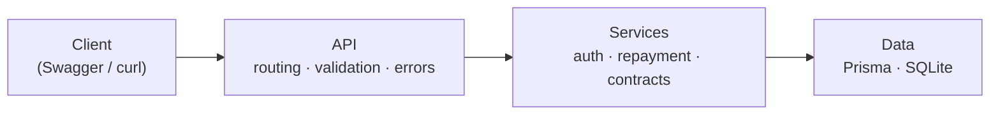
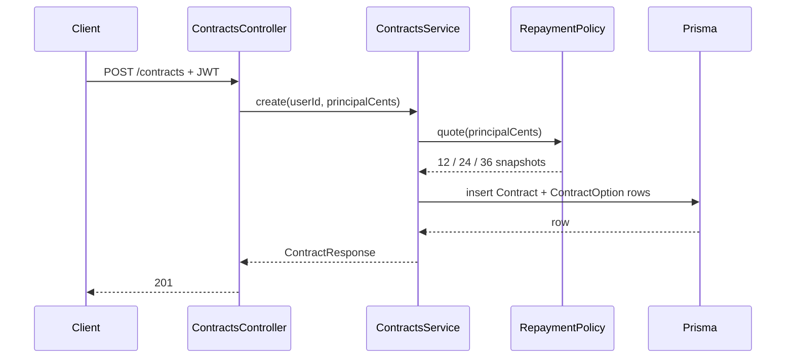
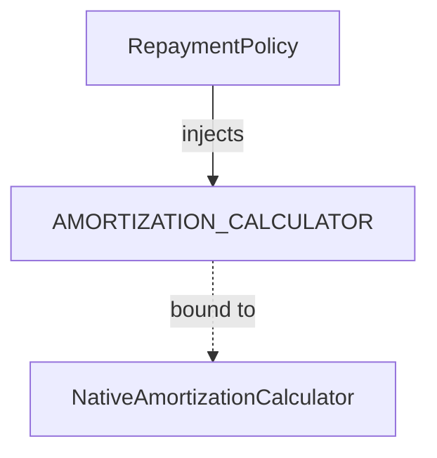
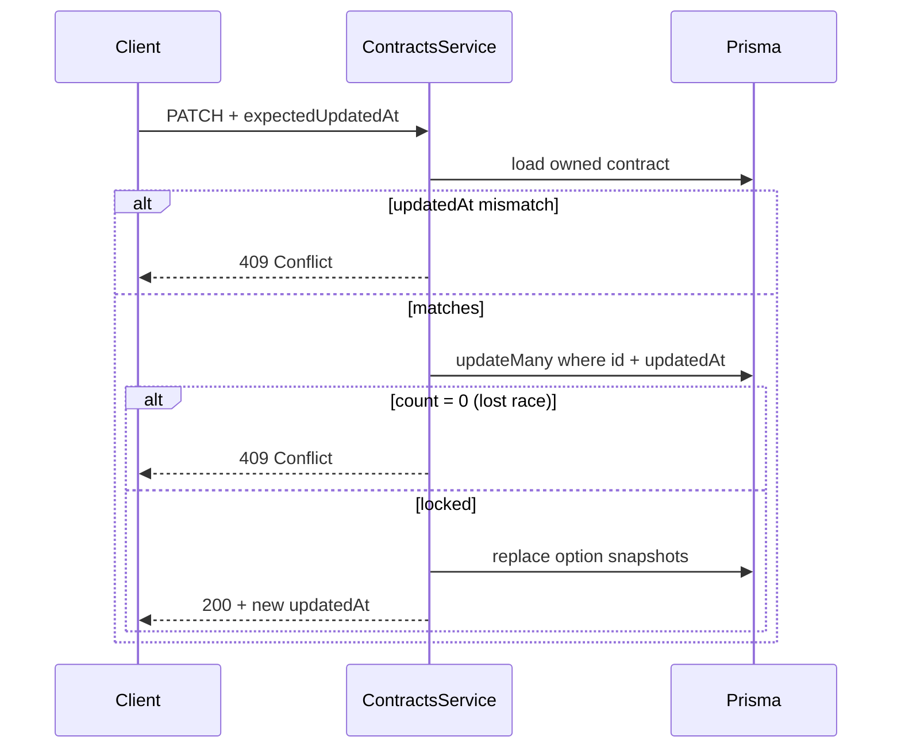
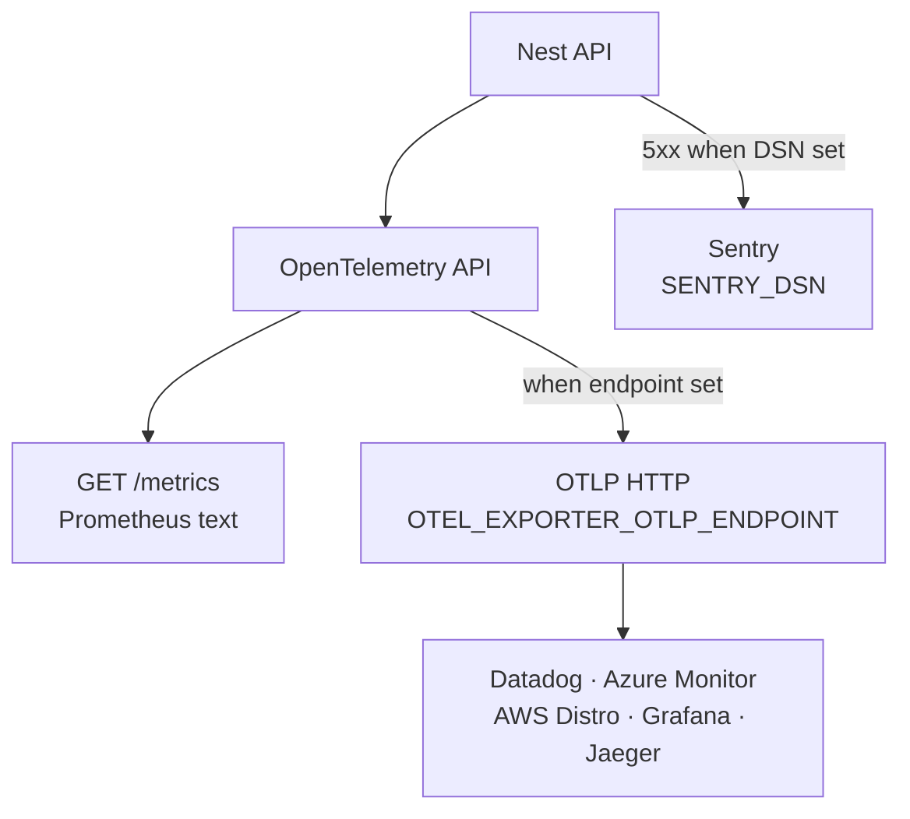

# Contract Repayment API

Backend for device repayment quotes: you register, send a principal in **integer cents**, and get **12 / 24 / 36-month** options at **6.5%**. Contracts are owned by the authenticated user (JWT). Optional Vite UI lives in [`web/`](./web) and runs separately from the API.

Released on [`main`](https://github.com/Tlhogi007/contract-repayment-api) as **[v1.5.0](https://github.com/Tlhogi007/contract-repayment-api/releases/tag/v1.5.0)**. Needs Node **22+**; no Postgres install for a local run.

|          | Local                              | Live (Render)                                            |
| -------- | ---------------------------------- | -------------------------------------------------------- |
| UI       | http://localhost:5173 (`web:dev`)  | — (static host next)                                     |
| API      | http://localhost:3000              | https://contract-repayment-api.onrender.com              |
| Liveness | http://localhost:3000/health       | https://contract-repayment-api.onrender.com/health       |
| Ready    | http://localhost:3000/health/ready | https://contract-repayment-api.onrender.com/health/ready |
| Metrics  | http://localhost:3000/metrics      | https://contract-repayment-api.onrender.com/metrics      |
| Swagger  | http://localhost:3000/api/docs     | https://contract-repayment-api.onrender.com/api/docs     |

Free Render sleeps when idle (first hit can take ~30–50s) — warm `/health` once before a demo.

---

## Quick start

```bash
npm install
npm install --prefix web
cp .env.example .env
npx prisma migrate deploy
npm run start:dev          # API on :3000
npm run web:dev            # UI on :5173 (proxies API)
```

```bash
npm run validate   # typecheck, lint, format, unit + e2e, API build
npm run web:test:cov
npm run build:web
```

Unit coverage gate is **≥ 90%** (modules/controllers/DTOs stay out of the unit gate; e2e covers HTTP).

---

## Try it

```bash
# 1) Register
curl -s http://localhost:3000/auth/register \
  -H 'Content-Type: application/json' \
  -d '{"email":"demo@example.com","password":"password123"}'

# 2) Create a contract (R1 000.00 → 100000 cents). Use accessToken from step 1.
curl -s http://localhost:3000/contracts \
  -H "Authorization: Bearer $TOKEN" \
  -H 'Content-Type: application/json' \
  -d '{"principalCents":100000}'
```

For `100000` cents the monthly payments should be **8630 / 4455 / 3065** (12 / 24 / 36). Swagger “Authorize” is the easiest way through full CRUD, including `expectedUpdatedAt` on PATCH.

---

## API

| Method   | Path             | Auth | Notes                                      |
| -------- | ---------------- | ---- | ------------------------------------------ |
| `POST`   | `/auth/register` | —    | Create account                             |
| `POST`   | `/auth/login`    | —    | Issue JWT                                  |
| `GET`    | `/auth/me`       | JWT  | Current user                               |
| `POST`   | `/contracts`     | JWT  | Create + snapshot term options             |
| `GET`    | `/contracts`     | JWT  | List own contracts (`limit` / `cursor`)    |
| `GET`    | `/contracts/:id` | JWT  | Owner only                                 |
| `PATCH`  | `/contracts/:id` | JWT  | Recalc; body needs `expectedUpdatedAt`     |
| `DELETE` | `/contracts/:id` | JWT  | Delete                                     |
| `GET`    | `/health`        | —    | Liveness (process only)                    |
| `GET`    | `/health/ready`  | —    | Readiness (`SELECT 1`; **503** if DB down) |
| `GET`    | `/metrics`       | —    | Prometheus scrape (OpenTelemetry meters)   |
| `GET`    | `/api/docs`      | —    | Swagger UI                                 |

Someone else’s contract id returns **404** (not 403). A PATCH with a stale `expectedUpdatedAt` returns **409**. There is no `GET /` route.

---

## Architecture

Shape matches the brief: client → API → services → data. Nest modules replace a classic MVC layout.



Request path for a create:



`configureApp()` is shared by production and e2e: validation pipe, exception filter, request-id, access log, Swagger.

### Patterns in the code

| Pattern             | Where                                                | Why it’s there                                  |
| ------------------- | ---------------------------------------------------- | ----------------------------------------------- |
| Strategy            | `AmortizationCalculator` + `AMORTIZATION_CALCULATOR` | Swap the formula without touching the cents API |
| DI                  | Nest providers                                       | Tests can override cheaply                      |
| Factory             | `JwtModule.registerAsync`, `createValidationPipe()`  | Boot-time wiring                                |
| Guard + Passport    | `JwtAuthGuard`, `JwtStrategy`                        | Auth on routes; resolve the user                |
| Decorator           | `@CurrentUser()`                                     | Keep `@Req()` plumbing out of services          |
| Middleware / filter | request-id, access log, `AllExceptionsFilter`        | One error shape; correlated logs                |

### SOLID (short)

- **SRP** — controllers move bytes; services own use-cases; calculator owns math; Prisma owns persistence.
- **OCP / DIP** — `RepaymentPolicy` depends on the calculator token, not `NativeAmortizationCalculator`.
- **LSP / ISP** — any calculator with one `calculate` method can plug in.

Pricing Strategy wiring:



---

## Interest policy

Amortized monthly payment (reducing balance):

\[
M = P \frac{r(1+r)^{n}}{(1+r)^{n}-1}
\]

- \(P\) — principal in integer cents
- \(r\) — \(0.065 / 12\)
- \(n\) — 12, 24, or 36
- \(M\) — `Math.round` to the nearest cent; totals are monthly × term

Options (and the rate) are **snapshotted** on create/update so old contracts don’t silently change if the policy moves later.

---

## Design decisions

These are the trade-offs I’d defend in a review. Skim the section that matches the question.

### Platform

| Decision            | Choice                                     | Reason                                            |
| ------------------- | ------------------------------------------ | ------------------------------------------------- |
| Validation coercion | Off unless `@Type`                         | Money and identity fail closed                    |
| Errors              | Single `ApiErrorResponse`                  | Same shape for clients and logs                   |
| Correlation         | `x-request-id` + access log on `finish`    | Every response is traceable                       |
| Liveness vs ready   | `/health` vs `/health/ready`               | Probes can restart vs stop traffic separately     |
| Telemetry           | OpenTelemetry (Prometheus + optional OTLP) | Swap Datadog / Azure / AWS / Grafana via endpoint |
| Error reporting     | Optional `SENTRY_DSN`                      | Off locally; on in shared envs                    |
| Boot                | Shared `configureApp()`                    | E2e hits the real HTTP stack                      |

### Identity

| Decision     | Choice                             | Reason                                           |
| ------------ | ---------------------------------- | ------------------------------------------------ |
| Login        | `AuthService` (not passport-local) | One path for credentials; Passport only for JWT  |
| Failed login | Same `401` text                    | Avoid email enumeration                          |
| Tokens       | Access JWT only                    | Enough for this Bearer demo                      |
| Passwords    | bcrypt cost 10                     | Never returned                                   |
| DB           | Prisma + SQLite                    | Fast clone → run; schema stays Postgres-portable |

### Pricing

| Decision        | Choice                      | Reason                                              |
| --------------- | --------------------------- | --------------------------------------------------- |
| Interest        | Amortized @ 6.5%            | Brief requirement; golden-testable                  |
| Money           | Integer cents               | No float at the domain boundary                     |
| Rounding        | `Math.round` on monthly     | One rule; totals = monthly × term                   |
| Decimal library | Skipped                     | Fixed rate, three terms; cents + goldens are enough |
| Engine          | Strategy + DI               | Swap formula without churning callers               |
| Ceiling         | `MAX_PRINCIPAL_CENTS` (1e9) | Keeps option totals inside Prisma/SQLite `Int`      |

### Contracts

| Decision         | Choice                                      | Reason                                      |
| ---------------- | ------------------------------------------- | ------------------------------------------- |
| Ownership        | Owner-scoped; cross-user → `404`            | Don’t leak that an id exists                |
| Quotes           | Snapshot on write                           | History stays stable                        |
| Lists            | Cursor page (`limit` ≤ 100, default 20)     | Unbounded lists hurt first                  |
| Concurrent PATCH | `expectedUpdatedAt` required; stale → `409` | No silent overwrite                         |
| Race coverage    | E2e: one `200`, one `409`                   | Asserts the lock, not just a tidy final row |

Optimistic update flow:



---

## Scale & performance

The three quote calculations are cheap and stored on write. What actually bites under load is I/O, auth, and abuse — so that’s what we hardened first.

| Pressure           | Now                                                                    | If it grows                                         |
| ------------------ | ---------------------------------------------------------------------- | --------------------------------------------------- |
| `GET /contracts`   | Cursor page + hard max                                                 | Keep `userId` index; add covering indexes if needed |
| Auth / write abuse | 120/min global; auth 10/min; contract writes 30/min; `/health` skipped | Redis throttle across instances                     |
| Local DB           | SQLite for assessors                                                   | Point `DATABASE_URL` at Postgres                    |
| JWT validation     | Confirm user still exists                                              | Short TTL cache if auth QPS dominates               |
| bcrypt             | Cost 10                                                                | Keep; split auth only after measuring               |
| Concurrent edits   | Optimistic `expectedUpdatedAt` → `409`                                 | Integer `version` if clock skew becomes real        |
| Observability      | OTel meters + Prometheus `/metrics`; OTLP / Sentry when configured     | Turn on vendor backends with env only               |

Skipped on purpose for now: Redis for quotes, microservices, read replicas. Those cost more than they prove at this size.

---

## Monitoring

Production approach: **instrument once, export anywhere**. The app speaks OpenTelemetry; vendors plug in through env, not code forks.



| Signal            | How                                                 | Intended use                      |
| ----------------- | --------------------------------------------------- | --------------------------------- |
| Liveness          | `GET /health`                                       | Orchestrator restart              |
| Readiness         | `GET /health/ready`                                 | Stop routing on **503** (DB down) |
| Metrics / latency | OTel → Prometheus `/metrics` and/or OTLP            | Scrape or push to your backend    |
| Exceptions        | Access logs always; Sentry when `SENTRY_DSN` is set | Page on rising 5xx                |

Local clone needs none of the vendor env vars. To aim telemetry at a collector (or a vendor’s OTLP intake):

```bash
OTEL_EXPORTER_OTLP_ENDPOINT=http://localhost:4318
# optional
SENTRY_DSN=https://…@….ingest.sentry.io/…
```

---

## Scope

| In                                        | Out (v1)                          |
| ----------------------------------------- | --------------------------------- |
| Register / login (JWT)                    | Payment gateway                   |
| Owner-scoped contract CRUD                | Multi-tenant orgs / admin         |
| Deterministic 12/24/36 @ 6.5%             | Mobile clients                    |
| Validation, errors, logging, OpenAPI      | Distributed topology              |
| Health, readiness, OTel + optional Sentry | Hard-coded Datadog/Azure SDKs     |
| Unit + e2e per feature + thin Vite UI     | Redis throttle / managed Postgres |

---

## Deploy (live)

Hosted on **[Render](https://render.com)** (Docker from `main`). URLs are in the table at the top. Reviewers still clone with Node only — no Docker required.

**Required env on Render:** `NODE_ENV=production`, strong `JWT_SECRET`, `DATABASE_URL=file:/data/prod.db` (ephemeral on Free; add a disk or Postgres if you need persistence). See [`render.yaml`](./render.yaml) / [`Dockerfile`](./Dockerfile).

---

## Tooling & branches

| Concern     | Tool                                              |
| ----------- | ------------------------------------------------- |
| Runtime     | NestJS + TypeScript (Node 22+); Vite UI in `web/` |
| Persistence | Prisma + SQLite locally                           |
| Auth        | bcrypt + JWT Bearer                               |
| Quality     | ESLint, Prettier, Husky, lint-staged, commitlint  |
| Release     | semantic-release → GitHub Releases + CHANGELOG    |
| CI          | GitHub Actions on `main` / `develop`              |

`main` is releasable (semantic-release). `develop` is the default PR target. See [CONTRIBUTING.md](./CONTRIBUTING.md).

---

## How it was built

1. Engineering template — hooks, CI, branches
2. Platform — config, validation, Swagger, errors, logging
3. Identity — register/login, bcrypt, JWT
4. Pricing — `RepaymentPolicy` + Strategy DI + golden tests
5. Contracts — CRUD, ownership, snapshots
6. Hardening — expired JWT, IDOR, ceiling, cascade, race smoke
7. Milestone — **v1.1.0**
8. Scale posture — pagination + rate limits → **v1.2.0**
9. Optimistic concurrency → **v1.3.0**
10. Monitoring — readiness, OpenTelemetry (Prometheus + optional OTLP), optional Sentry → **v1.4.0**
11. Deploy — Render + Docker → **v1.5.0** (live URL in README; reviewers stay on npm)
12. Thin Vite UI in `web/` (separate from the API process)
13. Still optional — Redis throttle store, managed Postgres; static UI host

PRs stay small and reviewable. Secrets stay out of git; rotate `JWT_SECRET` before anything shared. Pricing/platform invariants live in unit tests; auth and contract journeys live in e2e. When the “why” matters more than the diff, it lands in this README.

## License

UNLICENSED — assessment / team submission.
